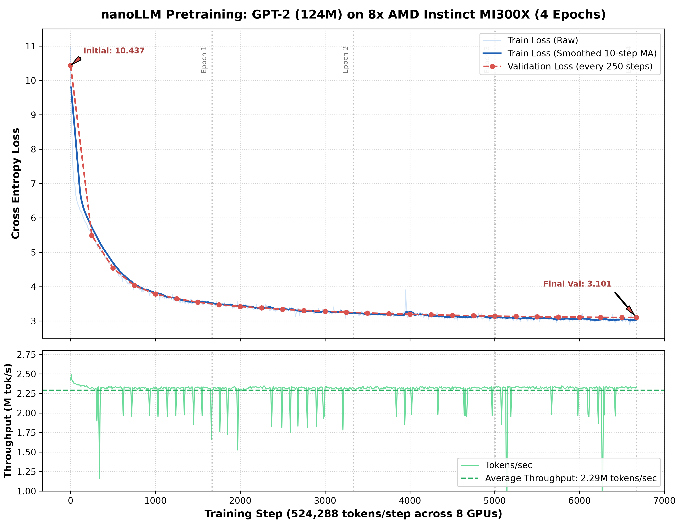

# nanoLLM

A minimal, high-performance PyTorch implementation for pretraining autoregressive language models, scaled across 8x AMD Instinct MI300X GPUs.

---

## Benchmark & Training Results

| Commit / Milestone | Model | Params | Hardware | Global Batch | Throughput | Step Time | Train Loss | Val Loss | Total Time | Notes |
|:---|:---:|:---:|:---:|:---:|:---:|:---:|:---:|:---:|:---:|:---|
| [`v0.1.0`](https://github.com/parikshit/nanoLLM/releases/tag/v0.1.0) | GPT-2 | 124M | 8x MI300X | 524,288 tok | **~2.29M tok/s** | **244 ms** | **3.049** | **3.101** | ~28 min (4 ep) | FlashAttention (SDPA), BF16, `torch.compile`, Fused AdamW, DDP (RCCL) |

* **Total Tokens Trained**: ~3.50 Billion tokens (4 full epochs over 16 ClimbMix shards).
* **Global Batch Size**: $524,288$ tokens per step ($64\text{ microbatch} \times 1024\text{ seq len} \times 8\text{ GPUs}$, `grad_accum_steps = 1`).

---

## 4-Epoch Training & Validation Loss Curves

Generated via `python plot_loss.py`:



---

## Model Architecture & Hyperparameters

| Hyperparameter | Value | Description |
|:---|:---:|:---|
| **Parameters ($N$)** | 124,475,904 (~124.5M) | Non-embedding params + shared embeddings |
| **Layers ($L$)** | 12 | Transformer decoder blocks |
| **Attention Heads ($H$)** | 12 | Multi-Head Self-Attention |
| **Embedding Dimension ($D$)** | 768 | Hidden state size ($64$ per head) |
| **Vocabulary Size ($V$)** | 50,304 | GPT-2 BPE (padded to nearest multiple of 64) |
| **Context Length ($T$)** | 1024 | Maximum block sequence length |
| **Attention Kernel** | PyTorch SDPA | Flash Attention implementation via ROCm |
| **Weight Initialization** | GPT-2 scaled init | Normal ($\mu=0, \sigma=0.02$), residual scaled by $1/\sqrt{2L}$ |
| **Weight Tying** | Enabled | Input token embedding tied with LM head projection |
| **Compilation** | `torch.compile` | Inductor backend with Triton-ROCm |
| **Precision** | `torch.bfloat16` | Autocast for forward & loss computation |
| **Optimizer** | Fused AdamW | $\text{lr}=6\times 10^{-4}, \beta_1=0.9, \beta_2=0.95, \text{decay}=0.1$ |
| **LR Schedule** | Cosine Annealing | 50-step linear warmup down to $10\%$ minimum LR |

---

## Hardware Platform

Training is performed on an AMD Instinct MI300X node managed via Flux:

* **Accelerators**: 8x AMD Instinct MI300X OAM (`gfx942`, 750W TDP)
* **VRAM**: 192 GB HBM3 per GPU (**1.536 TB total VRAM**)
* **Memory Bandwidth**: 5.3 TB/s per GPU (**42.4 TB/s aggregate**)
* **Interconnect**: 8-way fully-connected Infinity Fabric mesh (896 GB/s bidirectional per GPU)
* **CPUs**: 128 cores AMD EPYC
* **Software**: ROCm 7.0 + PyTorch 2.10.0 + RCCL (NCCL backend)

---

## Quickstart

### 1. Environment Setup

```bash
# Create and activate virtual environment
python3 -m venv nanollm
source nanollm/bin/activate

# Install PyTorch with ROCm 7.0 and dependencies
pip install --extra-index-url https://download.pytorch.org/whl/rocm7.0 torch torchvision torchaudio
pip install -r requirements.txt
pip install matplotlib
```

### 2. Prepare Dataset (ClimbMix)

Tokenize and shard ClimbMix into NumPy `uint16` files:

```bash
# Submit via Flux
flux batch prepare_climbmix_flux.sh

# Or run interactively
python climbmix.py --output-dir climbmix_small --workers 15
```

### 3. Distributed Training on 8x MI300X (Flux)

Submit pretraining job across all 8 GPUs using Flux:

```bash
flux batch run_flux.sh
```

Or run directly with `torchrun`:

```bash
python -m torch.distributed.run \
  --standalone \
  --nnodes=1 \
  --nproc-per-node=8 \
  train_gpt2.py
```
